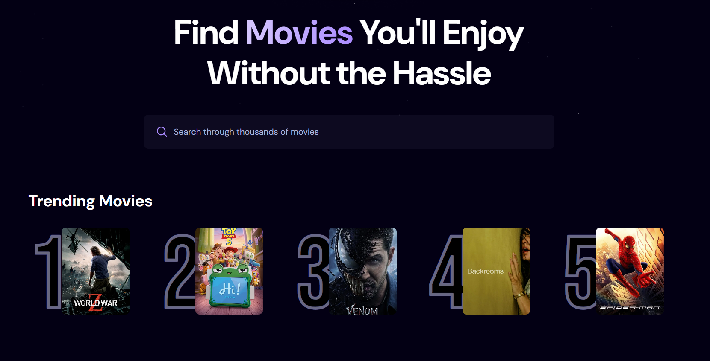
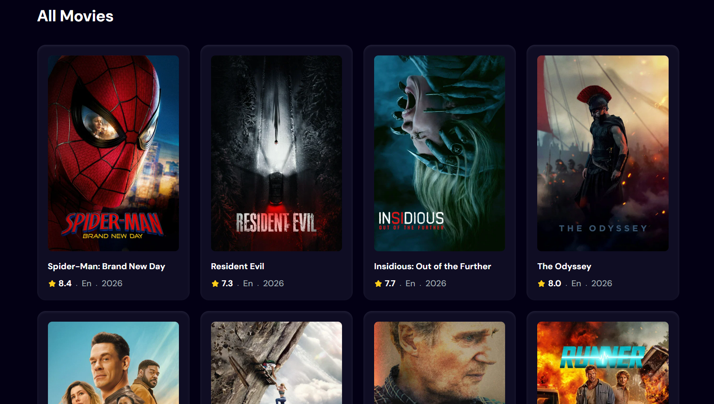

# Cinema react app

## Краткое описание
Приложение кинокаталог. Есть возможность поиска фильмов, лента трендовых фильмов. Каждая карточка фильма содержит: название, рейтинг, язык, год выпуска, постер.

## Стек / Технологии

- React --> JS библиотека
- Appwrite --> BaaS платформа (БД)
- TMDB --> бесплатный открытый онлайн-сервис о фильмах и сериалах
- Tailwind --> CSS фреймворк
- Vite --> сборщик

## Запуск

### Локально

```bash
npm install
cp .env.example .env   # заполнить переменные TMDB и Appwrite
npm run dev
```

Приложение поднимется на `http://localhost:5173`.

## Переменные окружения

| Переменная                       | Описание                                       | Получение                                                      |
| ---------------------------------| -----------------------------------------------| ---------------------------------------------------------------|
| VITE_TMDB_API_KEY                | API ключ сервиса TMDB                          | На официальном сайте TMDB после регистрации                    |
| VITE_APPWRITE_PROJECT_ID         | Id вашего проекта в сервисе Appwrite           | На платформе Appwrite после регистрации и создания проекта     |
| VITE_APPWRITE_DATABASE_ID         | Id базы данных проекта в сервисе Appwrite      | На платформе Appwrite после регистрации и создания проекта     |
| VITE_APPWRITE_COLLECTION_ID      | Id коллекции проекта в сервисе Appwrite        | На платформе Appwrite после регистрации и создания проекта     |


## Возможности

- **Просмотр таблицы:** таблица популярных и актуальных кино новинок с рейтингом, годом выпуска и языком оригинала
- **Поиск фильмов:** удобная строка поиска для получения необходимых фильмов
- **Топ лучших:** 5 самых популярных фильмов по поиску в приложении

<details>
<summary>Нажмите, чтобы посмотреть скриншоты</summary>


</details>